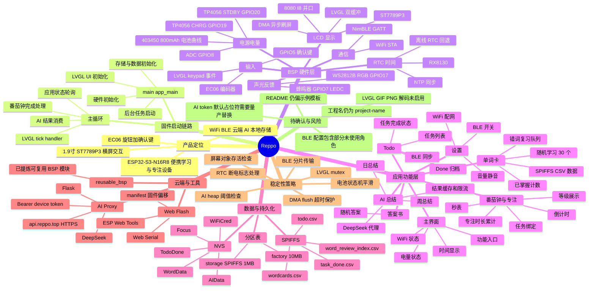
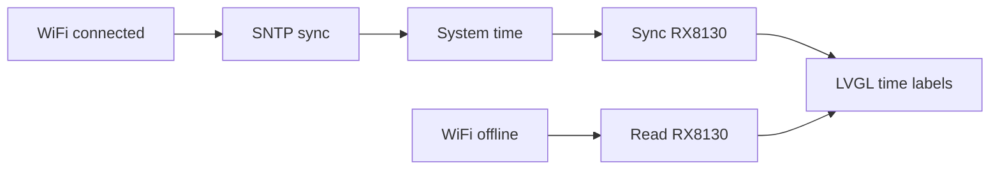
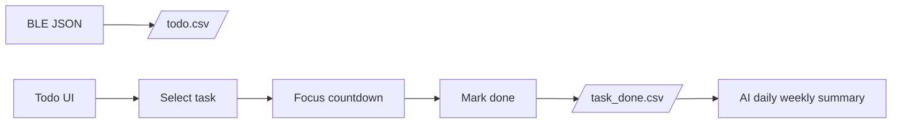
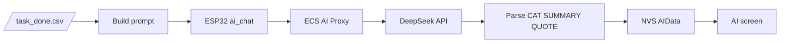
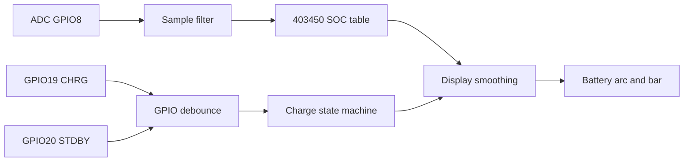

# Reppo 功能思维导图清单

生成时间：2026-06-23  
分析范围：当前 ESP-IDF 工程源码、BSP 组件、LVGL UI、数据分区、AI 代理服务、网页烧录工具。  
说明：本文件基于静态代码阅读整理，未包含硬件实测结果。

## 1. 总体思维导图

## 2. 项目架构总览

Reppo 当前是一个 ESP-IDF 固件工程，主控目标为 ESP32-S3-N16R8。整体可以分成四层：

1. 硬件 BSP 层：屏幕、旋钮、RTC、电池、RGB、蜂鸣器、WiFi、BLE、AI HTTP 客户端等。
2. 系统服务层：NVS、SPIFFS、WiFi worker、NVS worker、LVGL port、时间同步、后台任务调度。
3. 应用功能层：主界面、Todo、番茄钟、专注模式、单词卡、错词复习、AI 总结、设置、答案书。
4. 外部工具层：AI 云端代理、网页一键烧录、复用 BSP 文档与模块。

核心入口在 `main/main.c`。启动后按顺序执行：

- `app_init_hardware()`：初始化 RGB、编码器、蜂鸣器、电池监测、RX8130。
- `app_init_storage_and_data()`：初始化 NVS、WiFi 凭据、SPIFFS、单词/Todo 数据、WiFi、NTP 状态。
- `app_init_lvgl_ui()`：初始化 LVGL、LCD、输入设备、UI、定时器、电量/时钟刷新。
- `app_init_start_workers()`：启动 NVS worker 和 WiFi worker。
- 主循环：处理 UI 状态、倒计时完成、AI 结果、BLE 状态、LVGL 刷新。

## 3. 功能清单

### 3.1 启动、任务和运行时

- [x] `main/main.c` 作为固件入口。
- [x] 初始化逻辑拆分到 `main/app_init.c`，避免 `app_main` 过长。
- [x] 主循环逻辑拆分到 `main/app_main_loop.c`。
- [x] 使用 FreeRTOS 双核运行：
  - NVS worker 固定 core0，栈 8192，优先级 10。
  - WiFi worker 固定 core1，栈 4096，优先级 10。
- [x] LVGL 通过 `lvgl_mutex` 串行化关键 UI 操作。
- [x] `esp_timer` 提供 LVGL tick。
- [x] 主循环每 2ms 调用一次 LVGL handler。
- [x] UI 层多处使用对象有效性检查，降低切屏后访问失效对象的风险。
- [ ] 项目根 README 仍是模板风格，未完整反映当前产品功能。
- [ ] 根工程名仍显示 `project-name`，网页烧录 manifest 也沿用该 bin 名。

### 3.2 显示与 LVGL

- [x] 屏幕驱动位于 `components/BSP/LCD`。
- [x] 目标屏幕：ST7789P3，1.9 寸，内部 240x320，横屏 UI 320x170。
- [x] 接口：8080 I8 并口。
- [x] 关键引脚：
  - RST GPIO39
  - CS GPIO38
  - DC GPIO45
  - WR GPIO48
  - BLK GPIO3
  - DB0 GPIO21
  - DB1 GPIO14
  - DB2 GPIO13
  - DB3 GPIO12
  - DB4 GPIO11
  - DB5 GPIO10
  - DB6 GPIO9
  - DB7 GPIO46
  - RD GPIO47
- [x] LCD 提供初始化、开关屏、清屏、同步/异步画图、DMA 完成回调。
- [x] `components/lv_port/lv_port_disp.c` 将 LCD 接入 LVGL。
- [x] LVGL 使用双缓冲，缓冲行数来自 `LCD_LVGL_BUF_LINES`。
- [x] flush callback 调用 `lcd_draw_bitmap_async()`，并等待 DMA 完成。
- [x] DMA flush 有 100ms 超时保护。
- [x] LVGL 配置启用 16-bit 色深。
- [x] LVGL 启用常用控件：arc、bar、button、canvas、image、label、line、slider、switch、textarea、table、animimg 等。
- [ ] `CONFIG_LV_USE_GIF` 未启用。
- [ ] `CONFIG_LV_USE_PNG` 未启用。
- [ ] `CONFIG_LV_USE_BMP` 未启用。
- [ ] 如果要自然语言生成任意图片/GIF，当前固件侧还需要补齐图片解码、资源打包、SPIFFS 资源索引和显示 API。

### 3.3 输入与 EC06 编码器

- [x] EC06 驱动位于 `components/BSP/encoder`。
- [x] 编码器 A/B 引脚为 GPIO1、GPIO2。
- [x] 确认键使用 GPIO5。
- [x] `components/lv_port/lv_port_indev.c` 注册为 LVGL keypad 输入。
- [x] 旋钮顺时针/逆时针映射到 `LV_KEY_NEXT` / `LV_KEY_PREV`。
- [x] 键盘输入模式下可切换左右方向行为。
- [x] 确认键映射到 `LV_KEY_ENTER`。
- [x] 确认键带 35ms 边沿去抖和 180ms 最小触发间隔。
- [x] 编码器驱动带事件间隔、空闲重置、反向噪声处理、方向锁定、毛刺过滤等稳定性策略。

### 3.4 时间系统与 RX8130

- [x] RX8130 驱动位于 `components/BSP/RX8130`。
- [x] 默认 I2C：SDA GPIO15、SCL GPIO16、I2C0。
- [x] RX8130 地址：0x32。
- [x] 启动时探测 RX8130 并执行 startup。
- [x] 处理 STOP/TEST/VLF/VBFF 等状态标志。
- [x] 支持从系统时间同步到 RX8130。
- [x] WiFi 在线时优先使用 SNTP 系统时间。
- [x] WiFi 离线时从 RX8130 读取时间。
- [x] UI 每 3 秒尝试刷新实时时钟。
- [x] Done 任务归档时从 RX8130 读取日期。
- [ ] 仓库中仍保留 DS3231 旧驱动，当前主链路未使用，后续可标注为 legacy。

### 3.5 电池、电量和充电状态

- [x] 电池驱动位于 `components/BSP/bat_percent`。
- [x] 电池型号目标：403450，800mAh，可充电锂电池。
- [x] 电压采样：GPIO8 / ADC1_CH7。
- [x] 分压电阻：100K + 100K，换算比例 x2。
- [x] ADC 衰减：12dB。
- [x] TP4056 信号：
  - BAT_CHARGE / CHRG：GPIO19，低有效。
  - BAT_FULL / STDBY：GPIO20，低有效。
- [x] 电池状态枚举：放电、充电、满电、恢复。
- [x] 采样策略：
  - 后台任务 200ms 周期。
  - ADC 约 2s 更新。
  - 多次采样并去掉极值。
  - GPIO 充电/满电信号做多数投票和去抖。
- [x] SOC 映射使用 403450 电池电压曲线，而不是简单线性百分比。
- [x] 充电时做慢速爬升，避免插入 Type-C 后百分比瞬间跳变。
- [x] 放电时上下行变化使用不同时间常数，降低显示抖动。
- [x] 满电状态需要稳定时间确认。
- [x] UI 对低电量、充电、电量条颜色有不同展示。

### 3.6 RGB 灯与蜂鸣器

- [x] RGB 驱动位于 `components/BSP/RGB`。
- [x] RGB 器件：WS2812B。
- [x] RGB 引脚：GPIO17。
- [x] LED 数量：10。
- [x] 支持单色设置、流光、快速流光、异步快速流光。
- [x] 启动阶段有 boot blink。
- [x] BLE 模式有专用流光提示。
- [x] AI 等待、AI 成功、AI 失败、AI 限流、番茄钟完成均有灯效。
- [x] 蜂鸣器驱动位于 `components/BSP/buzzer`。
- [x] 蜂鸣器引脚：GPIO7。
- [x] 使用 LEDC low speed timer/channel。
- [x] 支持频率、音量百分比、确认提示、超时提示音。
- [x] 通过 volume bridge 绑定静音状态。

### 3.7 WiFi 与网络时间

- [x] WiFi 驱动位于 `components/BSP/wifi`。
- [x] 支持 STA 模式连接。
- [x] 支持扫描 Top 5 WiFi 并显示到 WiFi 配网页。
- [x] 支持从 UI 输入密码并连接。
- [x] 成功连接后保存 SSID/密码到 NVS。
- [x] NVS namespace：`WifiCred`。
- [x] 最多保存 8 组 WiFi 凭据。
- [x] 断开回调会清除在线状态并使 NTP 状态失效。
- [x] 支持 SNTP 初始化、重试、停止、时间有效性检查。
- [x] WiFi worker 负责联网时间与离线 RTC 的切换。
- [x] sdkconfig 启用 WiFi 与 WPA3 相关能力。
- [ ] 当前 WiFi 扫描只展示 5 个热点，复杂场景下可能需要分页或排序策略。

### 3.8 BLE 通信

- [x] BLE 驱动位于 `components/BSP/bsp_ble`。
- [x] 使用 NimBLE。
- [x] 设备名：`REPPO_BLE_Device`。
- [x] GATT service UUID：0x00FF。
- [x] characteristic UUID：0xFF01。
- [x] 支持 READ、WRITE、WRITE_NO_RSP、NOTIFY。
- [x] 支持 Todo JSON 下发。
- [x] 支持大 JSON 分片传输：
  - 0x03 START
  - 0x04 CHUNK
  - 0x05 END
- [x] 支持 0x06 拉取 Todo 和 Done 归档数据。
- [x] Notify 使用小分片发送，避免 MTU/链路限制。
- [x] BLE 连接状态会回写到 UI。
- [x] BLE 开关逻辑在 NVS worker 中异步处理。
- [x] sdkconfig 中 NimBLE 内存分配使用 external memory。
- [ ] sdkconfig 中启用了 central/peripheral/broadcaster/observer 多角色，若量产只做外设可进一步收窄配置。

### 3.9 Todo 和 Done 归档

- [x] Todo 存储位于 `components/BSP/todo_storage`。
- [x] Todo 文件：`/spiffs/todo.csv`。
- [x] Done 归档文件：`/spiffs/task_done.csv`。
- [x] Todo CSV 格式：`name,duration_min,done`。
- [x] Done CSV 格式：`name,date,duration`。
- [x] 支持最多 100 条任务。
- [x] 任务名最大 128 字节。
- [x] Todo 完成状态通过 NVS `TodoDone/done_arr` 持久化。
- [x] 支持从 BLE JSON 应用 Todo。
- [x] 支持导出 BLE JSON bundle，包含 todo 和 taskDone。
- [x] 支持将已完成任务归档到 Done 文件。
- [x] 归档时会读取 RX8130 日期。
- [x] 归档后从 Todo 列表移除已完成项。
- [x] Done 文件会裁剪到最近 100 条。
- [x] UI 有 Todo 列表、选择、返回恢复、Done list 分页。
- [ ] 任务 CSV 对复杂逗号、换行文本的兼容需要关注，当前更适合受控格式。

### 3.10 番茄钟、专注和等级

- [x] 番茄钟逻辑主要位于 `components/ui_custom/custom/custom.c`。
- [x] 支持倒计时模式。
- [x] 支持秒表模式。
- [x] 支持开始、停止、继续、加减时间。
- [x] 倒计时完成后触发声光提醒。
- [x] 支持从 Todo 任务进入专注流程。
- [x] 专注完成后通过 bridge 更新任务完成和时长。
- [x] 支持累计全部专注时间。
- [x] 支持 focus level 展示。
- [x] 等级阈值包含 3、9、15、30、60、100、150、230、350、500 小时。

### 3.11 单词卡与错词复习

- [x] 单词存储位于 `components/BSP/word_storage`。
- [x] 单词文件优先 `/spiffs/wordcards.csv`。
- [x] 兼容 fallback `/spiffs/wordcard.csv`。
- [x] 错词索引文件：`/spiffs/word_review_index.csv`。
- [x] 学习进度 NVS：`WordData/learned_cnt`。
- [x] 单词结构包括 word、phonetic、definition。
- [x] 学习一轮随机抽取 30 个。
- [x] 使用 `esp_random()` 随机抽词。
- [x] 使用文件行偏移索引加速随机读取。
- [x] 大数组优先使用 PSRAM/external RAM。
- [x] 已掌握单词会增加 learned counter。
- [x] 错词会进入 review index。
- [x] 复习掌握后会从错词队列移除。
- [x] review index 保存为异步任务。

### 3.12 AI 日/周总结

- [x] AI HTTP 客户端位于 `components/BSP/ai_chat`。
- [x] 当前默认走代理模式：ESP32 -> ECS Proxy -> DeepSeek。
- [x] 固件代理地址默认 `https://api.reppo.top/v1/ai/summary`。
- [x] 设备 token 默认为占位符，需要部署时替换。
- [x] 直连模式兼容 OpenAI-style chat completions。
- [x] TLS 默认使用 ESP-IDF certificate bundle。
- [x] 请求前检查 internal heap，阈值约 16KB。
- [x] AI demo 支持日总结与周总结。
- [x] Daily 最多纳入 25 条 Done 任务。
- [x] Weekly 最多纳入 80 条 Done 任务。
- [x] 结果缓存到 NVS `AIData`。
- [x] 日/周请求各有限流，默认约 1 小时。
- [x] AI 输出解析格式：
  - `CAT1|name|percent`
  - `CAT2|name|percent`
  - `CAT3|name|percent`
  - `SUMMARY|text`
  - `QUOTE|text`
- [x] 若百分比总和在 95-105 之间，会归一化到 100。
- [x] 主循环处理 AI 成功、失败、超时和 UI 跳转。
- [x] 云端代理位于 `server/ai_proxy`。
- [x] 云端代理用 Flask + httpx 调 DeepSeek。
- [x] 云端代理用 Bearer token 鉴权。
- [x] 云端 README 包含 ECS、systemd、Nginx、HTTPS、api.reppo.top 部署说明。
- [ ] 设备端默认 token 是占位符，量产前必须替换。
- [ ] 当前 AI 功能主要是总结 Done 数据，不是任意自然语言生成固件的 agent 架构。

### 3.13 UI 页面与交互

- [x] UI 由 NXP Gui Guider 生成，位于 `components/ui_custom/generated`。
- [x] 自定义逻辑位于 `components/ui_custom/custom`。
- [x] 已识别页面包括：
  - 启动/Logo 页面 `screen_reppo`
  - 主界面 `screen_main`
  - Todo 列表 `screen_todolist`
  - Todo 选择 `screen_todosel`
  - Todo 返回/恢复 `screen_todoback`
  - 计时页面 `screen_timing`
  - 单词菜单 `screen_wordmeun`
  - 单词卡 `screen_wordcard`
  - 错词复习 `screen_reviewcard`
  - 番茄钟 `screen_pomodoro`
  - 设置 `screen_setting`
  - WiFi 配网 `screen_wificfg`
  - AI 页面 `screen_ai`
  - Done list `screen_donelist`
  - 答案书 `screen_answer`
  - Loading `screen_loading`
  - AI 获取结果 `screen_getanswer`
- [x] 事件处理集中在 `events_init.c`。
- [x] 按钮对象加入 LVGL group，配合旋钮/确认键导航。
- [x] 电池、时间、WiFi、AI、Done list 等 UI 由 app/custom 层定时或事件驱动更新。
- [x] 对 clock label 使用 static buffer，降低 LVGL heap 分配/释放风险。

### 3.14 数据分区与文件

- [x] 自定义分区表位于 `partitions.csv`。
- [x] 分区布局：
  - `nvs`：0x9000，16KB
  - `otadata`：0xd000，8KB
  - `phy_init`：0xf000，4KB
  - `factory`：0x10000，10MB
  - `storage`：0xa10000，1MB SPIFFS
- [x] `main/CMakeLists.txt` 使用 `spiffs_create_partition_image(storage ../data FLASH_IN_PROJECT)` 将 `data/` 打包进 SPIFFS。
- [x] `data/` 包含 Todo、Done、单词卡初始 CSV。
- [x] sdkconfig 启用 PSRAM，80MHz Octal，malloc 可使用外部 RAM。
- [x] sdkconfig 设置 `CONFIG_SPIRAM_MALLOC_ALWAYSINTERNAL=16384` 和内部保留 64KB。
- [x] LVGL 使用 custom malloc。

### 3.15 网页烧录工具

- [x] 网页烧录目录：`web-flash`。
- [x] 使用 ESP Web Tools / Web Serial。
- [x] 支持 Chrome / Edge 浏览器。
- [x] manifest 名称：Reppo OS。
- [x] 目标芯片：ESP32-S3。
- [x] 烧录偏移：
  - bootloader.bin -> 0x0
  - partition-table.bin -> 0x8000
  - ota_data_initial.bin -> 0xd000
  - project-name.bin -> 0x10000
  - storage.bin -> 0xa10000
- [x] 提供 macOS/Linux 和 Windows 的 prepare-firmware 脚本。
- [x] README 说明了 localhost/HTTPS/Web Serial 限制。
- [ ] 若工程正式命名为 Reppo，建议同步修改固件 bin 名与 manifest。

### 3.16 可复用 BSP 区域

- [x] 仓库中存在 `reusable_bsp`。
- [x] 该目录用于放置之前提炼的可复用 BSP 模块和说明。
- [x] 当前主固件仍使用 `components/BSP` 作为运行时 BSP。
- [ ] 后续若要跨项目复用，应以 `reusable_bsp` 为稳定接口来源，并持续同步从主项目验证过的 bugfix。

## 4. 关键硬件资源表

| 功能 | 器件/接口 | 引脚/参数 | 代码位置 |
|---|---|---|---|
| 主控 | ESP32-S3-N16R8 | 16MB Flash / 8MB PSRAM | sdkconfig |
| LCD | ST7789P3 8080-I8 | 320x170 UI，12MHz PCLK | components/BSP/LCD |
| LCD 背光 | GPIO3 | BLK | components/BSP/LCD |
| 编码器 | EC06 | A GPIO1，B GPIO2 | components/BSP/encoder |
| 确认键 | GPIO key | GPIO5 | components/lv_port |
| RTC | RX8130 | I2C0 SDA15 SCL16，0x32 | components/BSP/RX8130 |
| 电池 ADC | 100K/100K 分压 | GPIO8 / ADC1_CH7 | components/BSP/bat_percent |
| 充电状态 | TP4056 CHRG | GPIO19，低有效 | components/BSP/bat_percent |
| 满电状态 | TP4056 STDBY | GPIO20，低有效 | components/BSP/bat_percent |
| RGB | WS2812B | GPIO17，10 颗 | components/BSP/RGB |
| 蜂鸣器 | PWM/LEDC | GPIO7 | components/BSP/buzzer |
| WiFi | ESP-IDF WiFi STA | NVS 保存凭据 | components/BSP/wifi |
| BLE | NimBLE GATT | service 0x00FF / char 0xFF01 | components/BSP/bsp_ble |

## 5. 数据和状态流

### 5.1 时间流

### 5.2 Todo 与专注流

### 5.3 AI 总结流

### 5.4 电量显示流

## 6. 适合继续扩展的能力边界

- 自然语言生成固件：当前仓库里的 AI 总结是“设备端固定能力 + 云端 LLM 总结”，不是完整代码 agent。若要做到像 Codex/Cursor 一样改 C 文件，需要服务器侧具备工程副本、代码生成、编译、日志反馈、固件产物管理、沙箱和安全审查。
- 任意图片/GIF 显示：当前 LVGL 启用了 `lv_img` 和 `animimg`，但 PNG/GIF/BMP 解码未启用。要支持“显示小狗小猫照片/GIF”，需要图片生成或上传管线、图片压缩/转换、SPIFFS 打包或下载缓存、LVGL 解码器和屏幕适配。
- BLE 数据协议：现在主要覆盖 Todo/Done 同步。若后续自然语言控制硬件，应扩展为版本化命令协议，避免单一 opcode 持续膨胀。
- BSP 复用：主工程 BSP 与 app 逻辑仍存在耦合。跨项目复用应优先引用 `reusable_bsp`，并给每个模块维护硬件适配表、初始化参数和线程安全约束。

## 7. 当前主要风险点索引

- WiFi/BT/LVGL/AI 同时运行，对内部 RAM 有压力；虽然 PSRAM 已启用，但 DMA、WiFi、TLS、LVGL 部分仍需要内部 RAM。
- BLE NimBLE 配置较宽，量产前可按真实角色收窄，节省内存。
- AI 云端 token 当前默认值是占位符，不能作为正式设备密钥。
- `CONFIG_LV_USE_GIF/PNG/BMP` 均未启用，和“任意图片/动画显示”的目标不完全匹配。
- Todo CSV 格式对复杂文本不够强，后续大量自然语言输入任务时建议升级为 JSON 或更严格 CSV 转义。
- 工程名和 README 仍偏样板，后续发布、网页烧录、用户说明需要统一品牌与版本。

